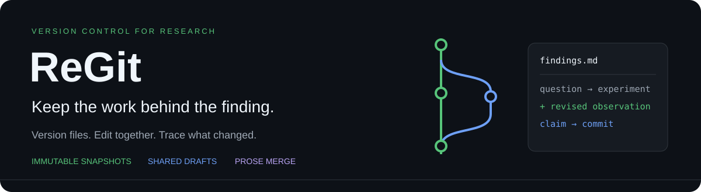
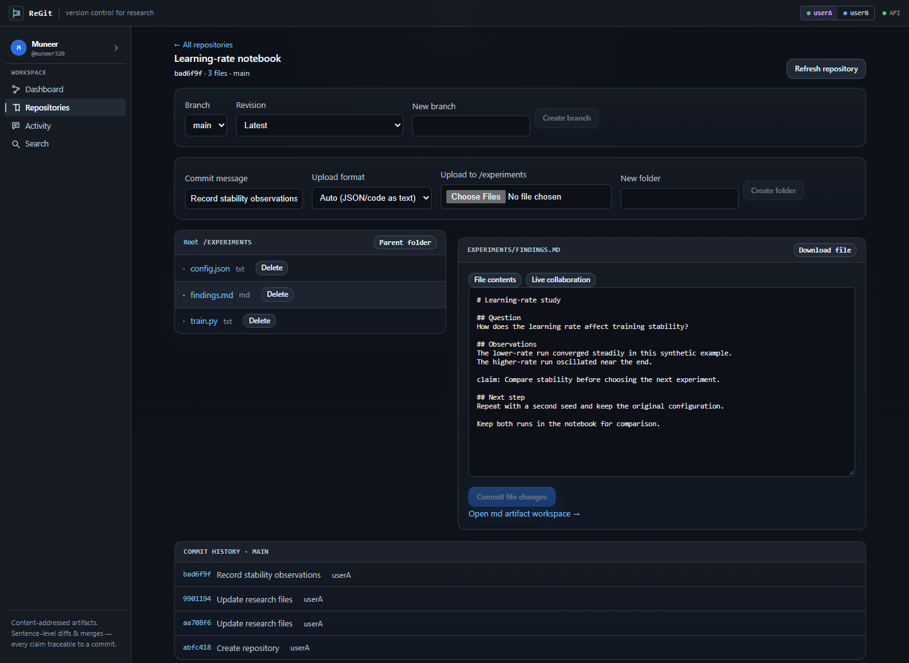
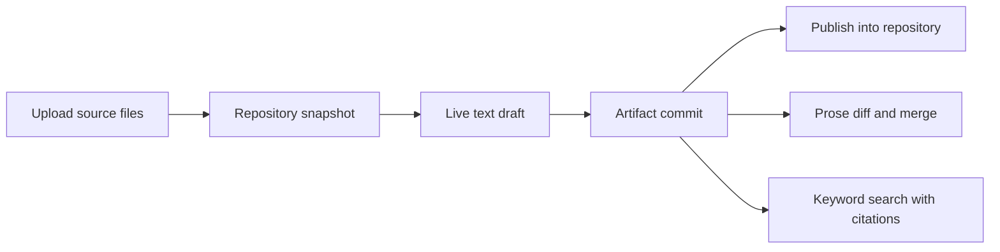
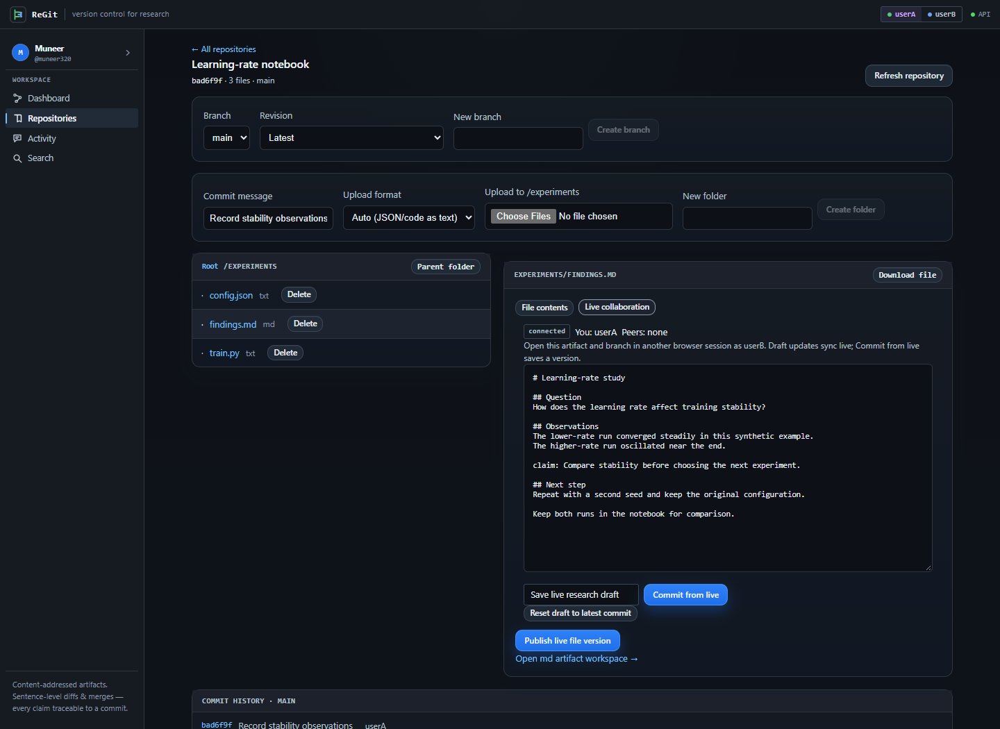
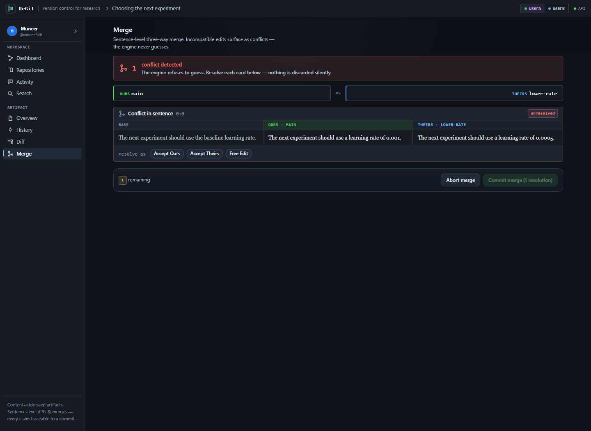
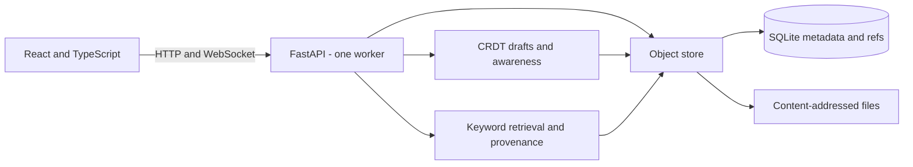

<div align="center">



**A local research workspace for versioned files, shared drafts and traceable changes.**

Keep notes beside their sources, explore a branch, and edit together without losing the earlier version.

[](https://github.com/Muneer320/ReGit/actions/workflows/ci.yml) [](LICENSE) [](pyproject.toml)

[**Try locally**](#try-it-locally) · [**Explore the workflow**](#from-source-files-to-a-shared-finding) · [**Developer guides**](#developer-guides)

</div>

## A finding has a history

Research moves between notes, source files and competing explanations. ReGit keeps those materials in versioned repositories: preserve the original bytes, work on a branch, compare prose and trace a search result back to its artifact and commit. Shared editing adds a live draft without making every keystroke a published repository revision.



*Real local application with a synthetic learning-rate notebook. The example observations are demonstration text, not experimental results.*

| Keep the source | Work together | Follow the change |
| --- | --- | --- |
| Nested folders, mixed file uploads, immutable snapshots and historical downloads | Live text drafts, peer presence, explicit commits and repository publication | Sentence-level prose diff/merge, branch history and keyword search with citations |

> [!NOTE]
> **Shared local prototype, built by Muneer Alam and Amrit Kang at Gradient Rush Hackathon in 2026.** User A/B are editing identities, not authenticated accounts. The verified demo runs on your machine; the older hosted frontend has no verified public backend.

## From source files to a shared finding



**Commit from live** saves an artifact version. **Publish live file version** pins that version into the repository snapshot. Earlier repository revisions retain their original file bytes and artifact references.

<details>
<summary><strong>See shared drafts and a prose conflict</strong></summary>



Open the same file in two isolated browser sessions to synchronize text and presence. This capture shows one connected editor; the two-session flow is covered by the browser smoke check.



Conflicting sentence edits require an explicit choice or free-text resolution. This example deliberately changes the same sentence on two branches. Repository-wide tree merge and PDF/codebase merge are not implemented.

</details>

## Try it locally

Install Git and Docker with Compose v2:

```sh
git clone https://github.com/Muneer320/ReGit.git
cd ReGit
docker compose -p regit-demo up --build --wait --wait-timeout 180
```

**Open [localhost:8377](http://127.0.0.1:8377).** One Python process serves the React interface, HTTP API and WebSockets. Local SQLite and content-addressed files retain the workspace. No account, API key, embedding model or external database is required; only a loopback web port is exposed.

1. Create a repository and a nested folder such as `notes/experiments`. Upload Markdown, text, code, ordinary JSON or a binary file. Auto treats ordinary JSON/code as text; explicit formats handle chat exports, PDFs and codebase ZIPs.
2. Edit a text file and **Commit file changes**. Create a branch, make another edit, then switch back. Earlier **Revisions** expose the original downloadable bytes.
3. Open **Live collaboration** for a text file in two browser sessions; select userB in the second. Edit, **Commit from live**, then **Publish live file version**.
4. Choose **Load merge example**, open `lr-stability.md` under Research artifacts and try **Merge prose**. Resolve a conflict, inspect the two-parent history, then search for indexed text and its citations.

The workspace starts empty. Choosing **Load merge example** creates examples; the README screenshots use a separately created synthetic notebook. The [walkthrough](docs/demo/demo-script.md) covers the full demo and restart checks.

Stop while retaining the named volume:

```sh
docker compose -p regit-demo stop
```

Use the same project name next time. Docker Desktop and native Windows setup are verified; CI also checks the Python backend on Linux and Windows.

## How the workspace fits together



Repository commits hold immutable tree manifests; branch references select a head. Expected-head checks reject stale writers, and failed upload batches roll back metadata/ref changes. Local CRDT drafts persist independently until explicitly committed and published.

> [!IMPORTANT]
> Run **one server worker per data directory**. This demo has no authenticated accounts or tenant boundaries. Deleting a file preserves its earlier revisions and is not secure erasure. Review the [data model](docs/data-model.md) before importing sensitive material.

<details>
<summary><strong>Versioning behavior, search, supported artifact types and limits</strong></summary>

Repository commits contain immutable tree manifests with folders, exact raw file hashes and pinned research-artifact commits. Only branch refs move. Mutations compare the expected repository head; a stale writer receives a conflict instead of overwriting another change. Failed upload batches roll back their metadata/ref changes.

Markdown/text artifacts support sentence diff, three-way prose merge, live drafts and explicit `claim:` provenance. Chat supports message diff through the API. PDF/codebase artifacts retain parsed representations and retrieval chunks; their merge/diff UI is not advertised as implemented. There is no repository-wide tree merge. Re-uploading a source creates a new parsed source/artifact while old repository snapshots remain accessible.

Draft edits are persisted with their CRDT identities, including uncommitted changes. A live commit refuses to overwrite a branch changed outside its draft. After reconciling/copying any pending edits, **Reset draft to latest commit** explicitly replaces the shared draft for all collaborators.

Prose merging can still alter paragraph layout; inspect the preview before accepting. A free-text conflict resolution may be empty to delete the conflicting text. Claims are explicit sentinel statements, not inferred scientific truth; claims-at-commit returns statements from that commit's ancestry.

Keyword search with citations is the default. Historical queries reconstruct the selected immutable artifact revision, so text replaced in the current index remains searchable. Historical retrieval is keyword-only. Optional Chroma/embedding dependencies require `uv sync --locked --extra vector`, a downloaded model and `GR_ENABLE_VECTORS=1`; that optional path is not included in the verified lightweight demo.

Repository uploads allow up to 50 files, 16 MiB per file and 64 MiB per batch. Raw files remain downloadable even when parsing extracts a different representation. Text editing is available for text/Markdown, not arbitrary binary data. Run one server worker per data directory; simultaneous server processes must not share it. Files and commits are retained for history, so deletion is not a secure-erasure feature.

</details>

## Develop and verify

<details>
<summary><strong>Native setup, hot reload and environment configuration</strong></summary>

Use Python 3.11+ (3.13 in CI/Docker), uv and Node.js 24:

```sh
python scripts/setup.py
uv run --locked uvicorn backend.src.api.main:app --host 127.0.0.1 --port 8377
```

Setup installs locked dependencies, builds the frontend and initializes the store. It downloads no embedding model by default. `GR_API_DATA_DIR` selects the data directory (default `data/`). For frontend hot reload, run `npm --prefix frontend run dev` separately; Vite uses port 5175 and proxies to the API on 8377.

</details>

<details>
<summary><strong>Tests, lint, build, two-browser collaboration and restart checks</strong></summary>

```sh
uv run --locked pytest -m "not vector" -q --timeout=60
uv run --locked ruff check backend tests --select F821,F822,F823,E9
npm --prefix frontend test
npm --prefix frontend run lint
npm --prefix frontend run build
```

With Compose running:

```sh
docker compose -p regit-demo exec -T regit /app/.venv/bin/python /app/scripts/smoke_demo.py --live --state-out /data/.smoke-state.json
node frontend/smoke.mjs
docker compose -p regit-demo restart regit
docker compose -p regit-demo up --wait --wait-timeout 180
docker compose -p regit-demo exec -T regit /app/.venv/bin/python /app/scripts/smoke_demo.py --live --verify-state /data/.smoke-state.json
```

The browser check requires frontend npm dependencies and an installed Chrome; set `CHROME_BIN` if needed. It opens two isolated sessions against the local server. Smoke checks create synthetic repositories/artifacts and retain their records for restart verification. CI runs Python tests on Linux/Windows, frontend tests/lint/build, Docker API/WebSocket checks, the real browser flow and restart persistence. Some frontend lint warnings remain; no hand-written test-count badge or throughput guarantee is used.

</details>

## Developer guides

| Explore and contribute | Understand the system |
| --- | --- |
| [Demo walkthrough](docs/demo/demo-script.md) | [Current architecture](docs/architecture.md) |
| [Demo questions](docs/demo/judge-qa.md) | [Data model](docs/data-model.md) |
| [Project explanation](docs/EXPLAINER.md) | [API guide](docs/specs/api-contract.md) |
| [Documentation index](docs/README.md) | [MIT license](LICENSE) |

The documentation index separates maintained guides from historical design notes. To report a bug, open an [issue](https://github.com/Muneer320/ReGit/issues) with the affected artifact type, action and reproduction steps. For a focused PR, run the relevant checks above, include a regression case for behavior changes and update affected guides. Use synthetic files and redact private material.

Built collaboratively by [Muneer Alam](https://github.com/Muneer320) and [Amrit Kang](https://github.com/amritkang165). Original contributions and history are preserved. Licensed under [MIT](LICENSE).
