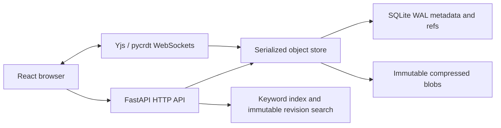

# Current architecture

One uvicorn worker serves the built frontend and API. Repository manifests pin raw bytes and research-artifact commits. Branch mutations use compare-and-swap refs; the shared SQLite connection uses a reentrant writer lock and nested savepoints. An upload batch either commits its metadata/tree or rolls back. Content-addressed disk blobs left after rollback can be registered safely on retry.

The research layer parses Markdown/text, explicit chat exports, PDFs and codebase ZIPs. Prose diff/merge operates on sentences; chat diff operates on messages. Repository-wide and codebase merges are not implemented. Raw repository downloads preserve the original bytes.

Live rooms hold a pycrdt document per artifact/branch, persist full CRDT identity/state and append incoming operations. Reconnecting Yjs clients exchange sync and awareness frames. Live commits check their base ref; shared draft reset is an explicit operation that preserves CRDT tombstones. Saved artifact versions publish into repository snapshots separately.

Claims are captured transactionally from prose `claim:` sentinels. Retrieval is derived data: ordinary queries use SQLite FTS; historical queries rebuild chunks from an immutable revision. Optional vectors are disabled in the lightweight demo. This is a shared local prototype with no account authentication or tenant boundary.
